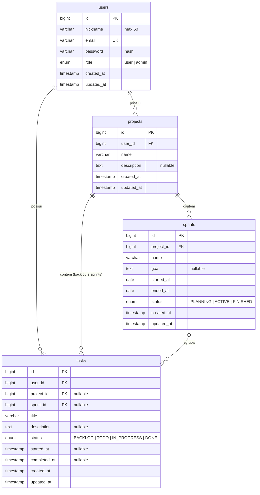

# 05. Modelo de Dados

Banco MySQL 8, criado pelas migrations em `backend/database/migrations`. O modelo segue *Privacy by Design*: não há nome completo nem dados sensíveis, e os timestamps de processo permitem calcular as métricas da pesquisa.

## 1. Diagrama entidade-relacionamento

## 2. Tabelas de domínio

Chaves primárias e estrangeiras são `BIGINT UNSIGNED` (padrão `$table->id()` / `foreignId()` do Laravel).

### 2.1 `users`

| Coluna | Tipo | Regras |
|--------|------|--------|
| `id` | bigint, PK | |
| `nickname` | varchar(50) | Obrigatório. Apelido pseudônimo, não precisa ser único. |
| `email` | varchar(255) | Obrigatório, único, normalizado para minúsculas. |
| `password` | varchar(255) | Hash (cast `hashed`). |
| `role` | enum(`user`, `admin`) | Padrão `user`. Indexado. |
| `created_at`, `updated_at` | timestamp | `created_at` é a "data de inscrição" e define o convite TAM. |

### 2.2 `projects`

| Coluna | Tipo | Regras |
|--------|------|--------|
| `id` | bigint, PK | |
| `user_id` | FK → `users.id` | `ON DELETE CASCADE` |
| `name` | varchar(255) | Obrigatório. |
| `description` | text | Opcional. |
| `created_at`, `updated_at` | timestamp | |

### 2.3 `sprints`

| Coluna | Tipo | Regras |
|--------|------|--------|
| `id` | bigint, PK | |
| `project_id` | FK → `projects.id` | `ON DELETE CASCADE` |
| `name` | varchar(255) | Obrigatório. |
| `goal` | text | Opcional (objetivo da sprint). |
| `started_at` | date | Obrigatório. |
| `ended_at` | date | Obrigatório, posterior a `started_at` (RN-13). Define o auto-close (RN-17). |
| `status` | enum(`PLANNING`, `ACTIVE`, `FINISHED`) | Padrão `PLANNING`. |
| `created_at`, `updated_at` | timestamp | |

Índice: `(project_id, status)` para a checagem de sprint ativa (RN-15).

### 2.4 `tasks` (tabela híbrida)

| Coluna | Tipo | Regras |
|--------|------|--------|
| `id` | bigint, PK | |
| `user_id` | FK → `users.id` | `ON DELETE CASCADE` |
| `project_id` | FK → `projects.id`, nullable | `NULL` = Kanban Geral. `ON DELETE CASCADE` |
| `sprint_id` | FK → `sprints.id`, nullable | `NULL` = Kanban Geral ou backlog. `ON DELETE SET NULL` (o serviço também reseta status e timestamps, RN-19) |
| `title` | varchar(255) | Obrigatório. |
| `description` | text | Opcional. |
| `status` | enum(`BACKLOG`, `TODO`, `IN_PROGRESS`, `DONE`) | Padrão do banco `TODO`; o serviço define o inicial por contexto. |
| `started_at` | timestamp, nullable | Primeira entrada em `IN_PROGRESS` (RN-22). |
| `completed_at` | timestamp, nullable | Conclusão atual (RN-22). |
| `created_at`, `updated_at` | timestamp | |

Índices: `(user_id, project_id, status)` para o WIP do Kanban Geral e `(user_id, sprint_id, status)` para o WIP da sprint.

### 2.5 Contexto de uma tarefa

| Contexto | `project_id` | `sprint_id` | Status possíveis |
|----------|--------------|-------------|------------------|
| Kanban Geral | `NULL` | `NULL` | `TODO`, `IN_PROGRESS`, `DONE` |
| Backlog do projeto | preenchido | `NULL` | `BACKLOG` |
| Sprint | preenchido | preenchido | `TODO`, `IN_PROGRESS`, `DONE` |

## 3. Tabelas de suporte (Laravel)

| Tabela | Uso no MyTask |
|--------|---------------|
| `cache`, `cache_locks` | **Necessária:** blacklist de tokens JWT invalidados no logout (`CACHE_STORE=database`). |
| `jobs`, `job_batches`, `failed_jobs` | Padrão do framework. Sem uso (fila `sync`). |
| `sessions`, `password_reset_tokens` | Padrão do framework. Sem uso funcional (API stateless; não há recuperação de senha por e-mail). |

## 4. Enums (PHP)

| Enum | Arquivo | Valores |
|------|---------|---------|
| `RoleEnum` | `app/Enums/RoleEnum.php` | `user`, `admin` |
| `SprintStatus` | `app/Enums/SprintStatus.php` | `PLANNING`, `ACTIVE`, `FINISHED` |
| `TaskStatus` | `app/Enums/TaskStatus.php` | `BACKLOG`, `TODO`, `IN_PROGRESS`, `DONE` |

Os enums do banco são gerados a partir desses arquivos (`array_column(Enum::cases(), 'value')`), então há uma única definição de valores.

## 5. Dados iniciais (seeder)

`DatabaseSeeder` cria (ou atualiza) o administrador a partir de `ADMIN_EMAIL`, `ADMIN_NICKNAME` e `ADMIN_PASSWORD`, e **também cria 5 participantes fictícios** via factory. Por isso o seeder completo serve apenas para desenvolvimento; em produção o administrador é criado com o comando descrito em [10](10-deploy.md#54-criar-o-administrador).
